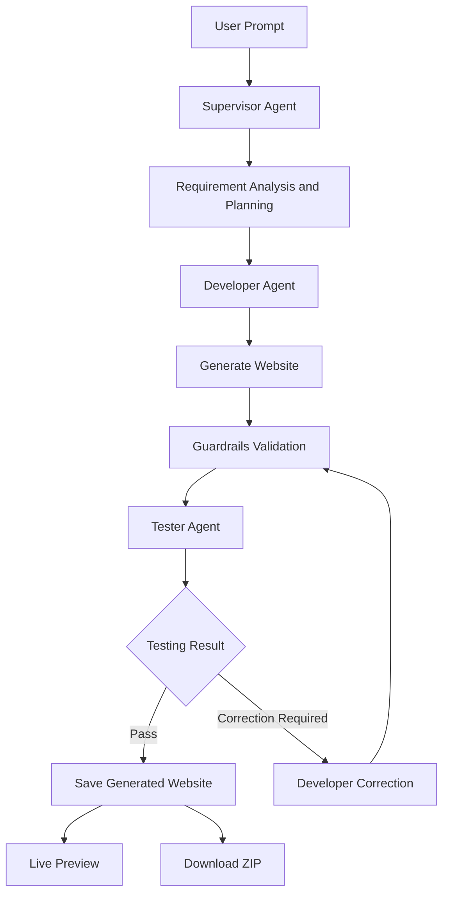

# Automatic Website Builder 🚀

### Build websites with AI. Plan, generate, test, and refine — automatically.

An AI-powered autonomous website builder that transforms natural-language prompts into functional websites through a multi-agent development workflow.

Instead of manually writing code, users describe what they want to build. A Supervisor Agent coordinates specialized agents to plan the application, generate code, test the implementation, and apply corrections when necessary.

---

## ✨ Features

- **Natural Language Development:** Describe your website or application using simple prompts.
- **Multi-Agent Architecture:** Specialized AI agents collaborate to build and validate websites.
- **AI-Powered Planning:** Supervisor Agent analyzes requirements and coordinates the development workflow.
- **Automated Code Generation:** Developer Agent generates website code based on the project requirements.
- **Automated Testing:** Tester Agent independently evaluates generated code and identifies potential issues.
- **Iterative Corrections:** Failed or incomplete checks can trigger developer corrections and another testing attempt.
- **Live Website Preview:** Preview generated websites directly inside the application.
- **Project Management:** Create, manage, and revisit multiple website projects.
- **Downloadable Projects:** Download generated websites as ZIP archives.
- **Authentication:** Secure user authentication and project ownership.

## 🧠 Multi-Agent Architecture

The platform follows a coordinated multi-agent workflow.



### Agent Responsibilities

| Agent | Responsibility |
|---|---|
| Supervisor Agent | Understands user requirements and coordinates the workflow. |
| Developer Agent | Generates and modifies website code. |
| Tester Agent | Independently evaluates generated output and identifies issues. |
| Guardrails | Validates generated files and enforces generation constraints. |

The orchestration layer manages communication between agents, workflow execution, validation, and correction attempts.

## 🛠️ Technology Stack

### Backend
- Python
- FastAPI
- SQLAlchemy
- Google Agent Development Kit (ADK)
- OpenRouter API
- JWT Authentication

### Frontend
- HTML5
- CSS3
- Tailwind CSS
- Vanilla JavaScript

### Database and AI
- SQLite (V1 database configuration)
- Large Language Models (LLMs)
- OpenRouter model integration


## 🖥️ Screenshots


## ⚙️ Getting Started

### Prerequisites

- Python 3.11+
- Git
- An OpenRouter API key
- Required environment variables configured for your application

### 1. Clone the Repository

```bash
git clone https://github.com/YOUR_USERNAME/Automatic-Website-Builder.git

cd Automatic-Website-Builder
```

### 2. Create a Virtual Environment

```bash
python -m venv venv
```

Activate it:

**Windows**

```bash
venv\Scripts\activate
```

**Linux / macOS**

```bash
source venv/bin/activate
```

### 3. Install Dependencies

```bash
pip install -r requirements.txt
```

### 4. Configure Environment Variables

Create a `.env` file using `.env.example` as a reference.

Configure the required application settings, including:

- OpenRouter API key
- LLM model configuration
- JWT secret
- Database configuration
- Application port

Never commit your `.env` file or API credentials.

### 5. Start the Application

From the project root:

```bash
uvicorn app.main:app --reload
```

Open the application at:

```text
http://localhost:8000
```

API health endpoint:

```text
http://localhost:8000/api/health
```

## 🔄 Application Workflow

1. Register or sign in to your account.
2. Create a new project.
3. Describe the website you want to build.
4. The Supervisor Agent analyzes the request and coordinates development.
5. The Developer Agent generates the website.
6. Guardrails validate the generated output.
7. The Tester Agent evaluates the implementation.
8. If corrections are required, the Developer Agent gets another opportunity to improve the output.
9. Preview the generated website.
10. Download the completed project as a ZIP archive.

## 🔒 Security

The application includes:

- JWT-based authentication.
- Project ownership validation.
- Protected API endpoints.
- Preview token validation.
- Generated-file path validation.
- Environment-based secret configuration.

## 🚧 Current Scope

The initial version focuses on generating frontend websites using HTML, CSS, Tailwind CSS, and vanilla JavaScript.

The objective is to establish a reliable autonomous development workflow before expanding into more advanced capabilities.


## 🤝 Contributing

Contributions, suggestions, and bug reports are welcome.

1. Fork the repository.
2. Create a feature branch.
3. Commit your changes.
4. Push the branch.
5. Open a Pull Request.

## 📄 License

This project is currently under development. Add a license before distributing or accepting contributions under specific licensing terms.

---

**Automatic Website Builder** — Turning ideas into websites through autonomous AI agents.

**Have an idea? Build it with AI.**
